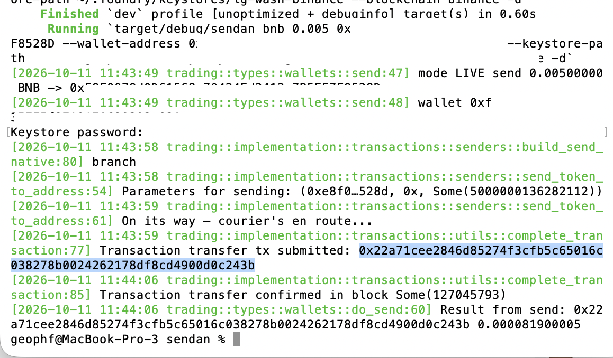
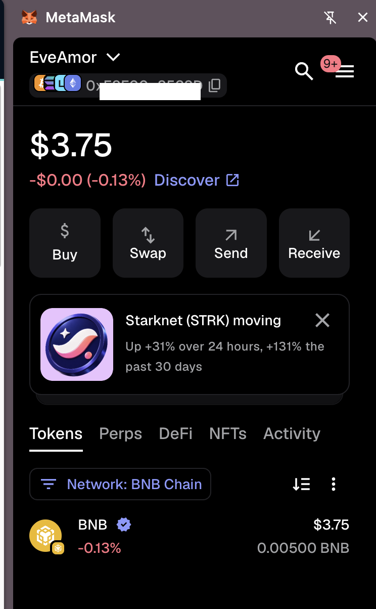

# `sendan` native tokens

HWÆT, pivoteurs, and well-met!

Good news! `sendan` is now able to send native tokens to another wallet 
(meaning: sending AVAX), whereas before it could not do this.

Theoretically, this works across blockchains.

I'll test `sendan` on Binance Smart Chain (BSC) next. 

# Multi-chain

Hooray! 🎉

I sent [BNB on Binance Smart Chain to an 
address](https://bscscan.com/tx/0x22a71cee2846d85274f3cfb5c65016c038278b0024262178df8cd4900d0c243b).

This is the first proof of multi-chain operations using the Pivot Protocol 
tools, so, when we do go multi-chain in production, we have already this 
foundation.

Woot! 
