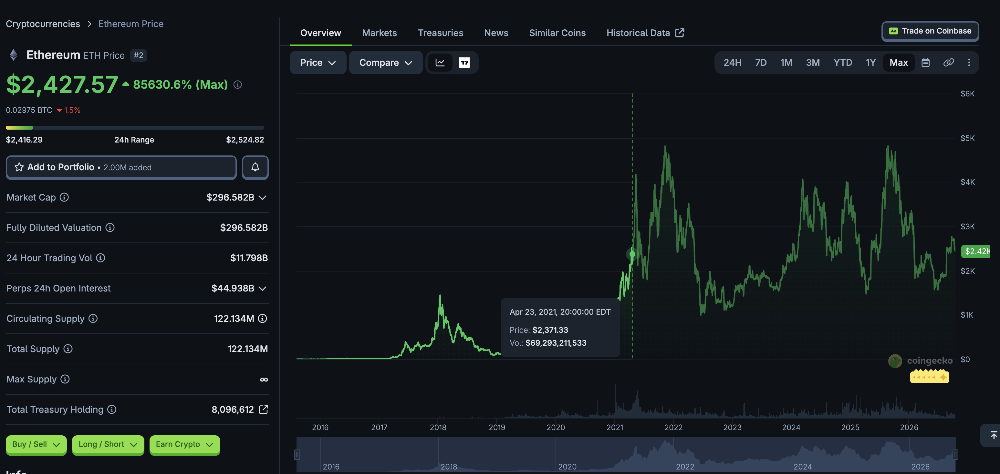
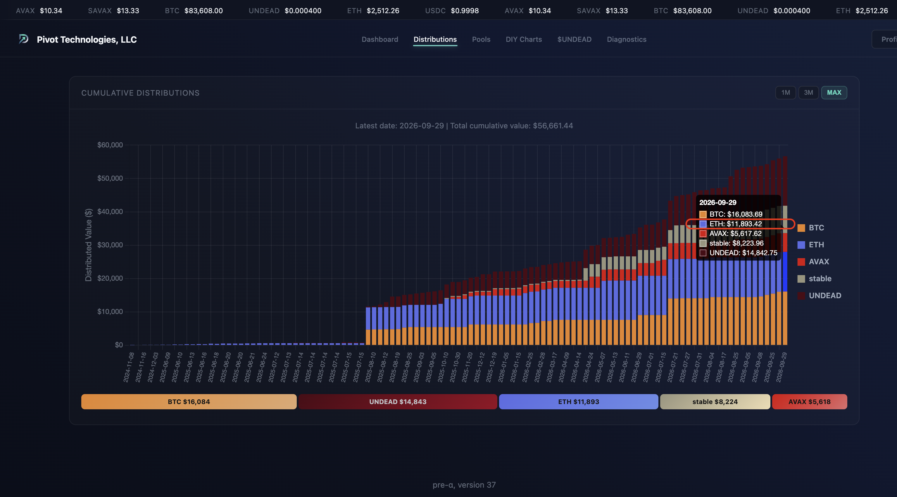
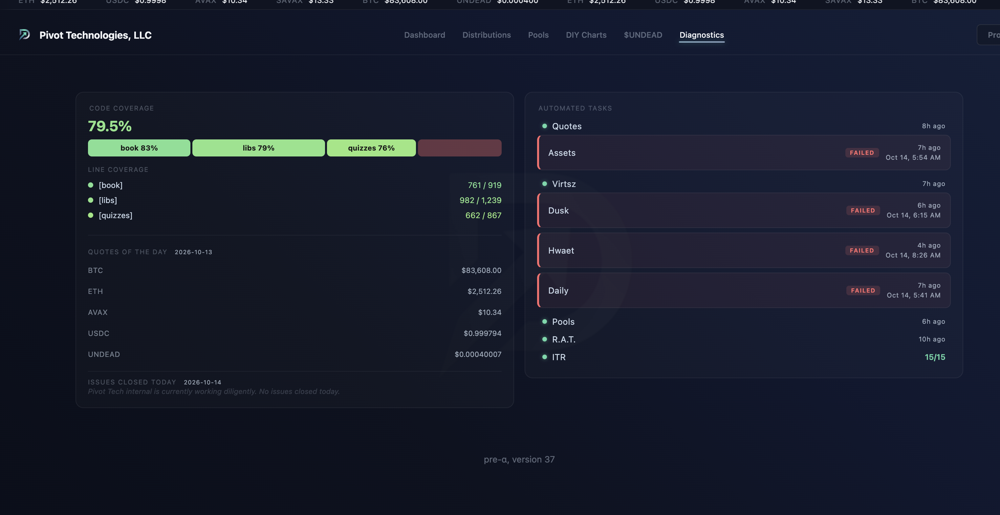

# 'stable' coin

Shhh! You're scaring the children!

Actually, finding a stablecoin with pivot arbitrage is a boon, why? Because I 
can pivot into and out of this token, and make money in both directions.

And: 'stable'?

You're ignoring the Ethereum chart for the last 5 years, but okay. 

# ETH distributions

HWÆT, pivoteurs, and well-met!

Some have a beef with the Ethereum price-needle seemingly being stuck on the 
$2,500-mark (forgetting that ETH at $800 was a huge price-jump, back in my 
day!), ... me, included.

But, with pivot arbitrage, I'm made $1,000s, no 10s of $1,000s on ETH.

# Protocol health

Ugh.

My `quotes` dapp failed, concatenating today's quotes onto yesterdays, causing 
all dapps that depend on quotes.csv to fail.

I have to rerun all dapps to get the protocol back up to status quo. ugh.

[issue id](https://github.com/pivoteur/pivoteur.github.io/issues/193)
