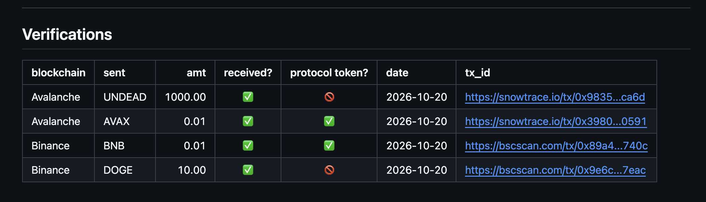

# Automation

HWÆT, pivoteurs, and well-met!

Automation-work proceeds apace.

## `sendan`

I've verified the ability to send protocol and non-protocol tokens 
intra-blockchain with 
[`sendan`](https://github.com/pivoteur/trading/tree/main/dapps/sendan).

## `ceap`

As for my trading-dapp, `ceap` (pronounced: 'cart'),

* it trades non-protocol tokens fine (e.g. [UNDEAD to 
USDC](https://snowtrace.io/tx/0x1d830b179a37ed61c3816aa5cf57d5bd58888071aa14ff3b1b95952e1774106a))
* but protocol token trades fail (e.g. trades with AVAX)

This is a EVM-blockchain particularity. I'm coding a solution to this 
[issue](https://github.com/pivoteur/trading/issues/157)
