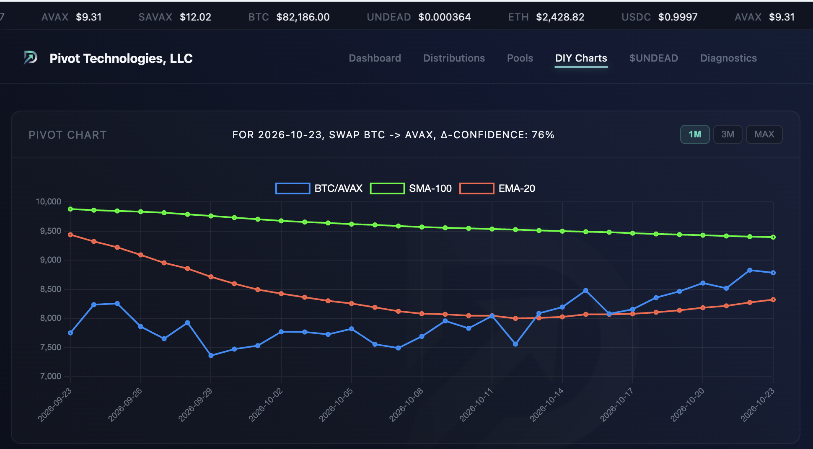
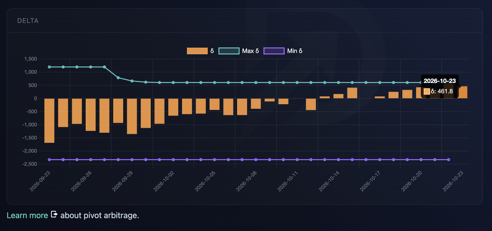
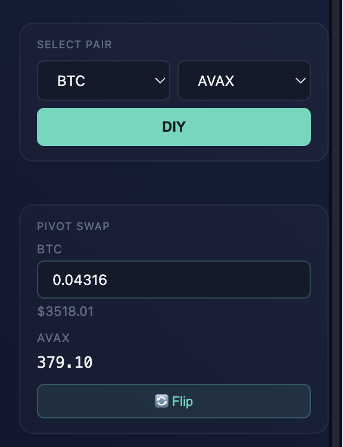
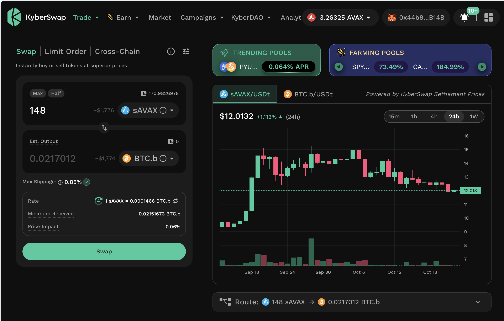
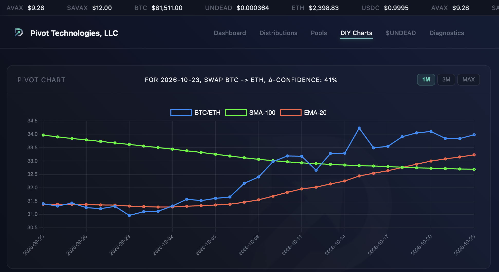
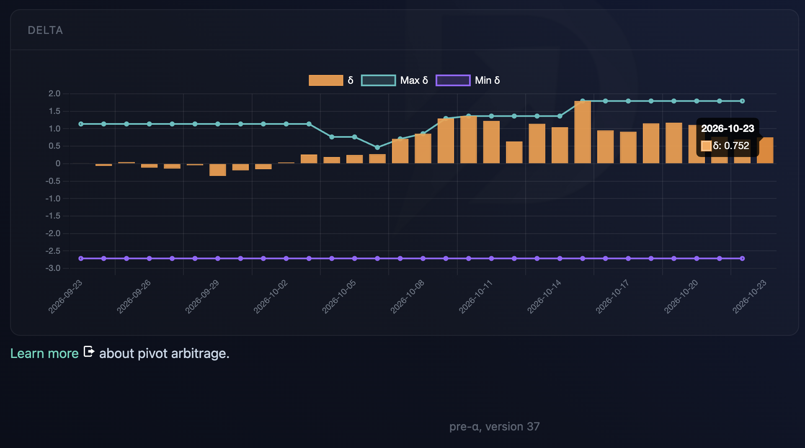
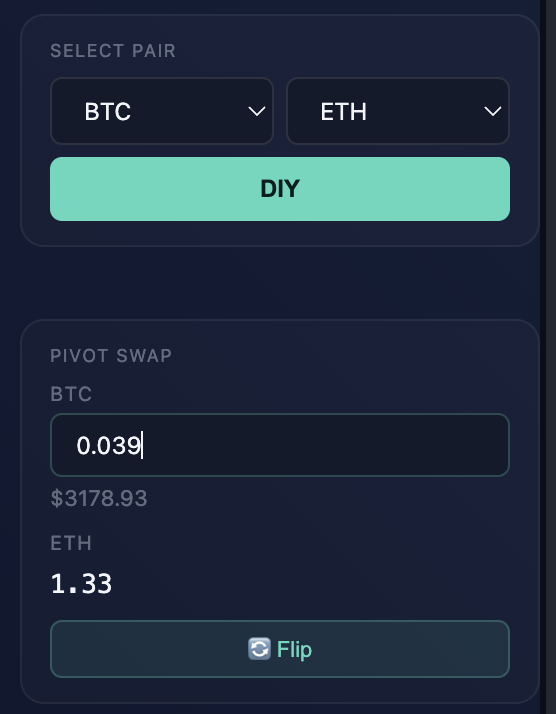
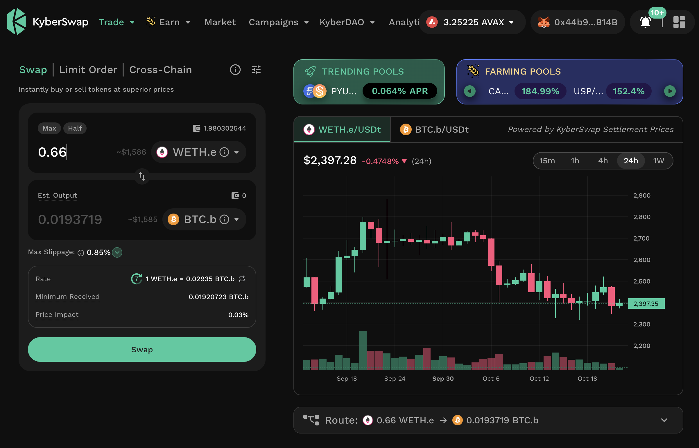

# Automation

## `ceap`

HWÆT, pivoteurs, and well-met

[`ceap`](https://github.com/pivoteur/trading/tree/main/dapps/ceap) – my dapp 
that trades assets – now works with native assets on both Avalanche and 
Binance blockchains.

# PIVOTS

## BTC+AVAX

Let's open a BTC-on-AVAX pivot and a AVAX-on-BTC hedge, as per [indicators on 
the Pivot Protocol](https://pivoteur.github.io/diy.html?t1=BTC&t2=AVAX).

## BTC+ETH

I open a BTC-on-ETH pivot and an ETH-on-BTC hedge as per 
[indicators](https://pivoteur.github.io/diy.html?t1=BTC&t2=ETH).

