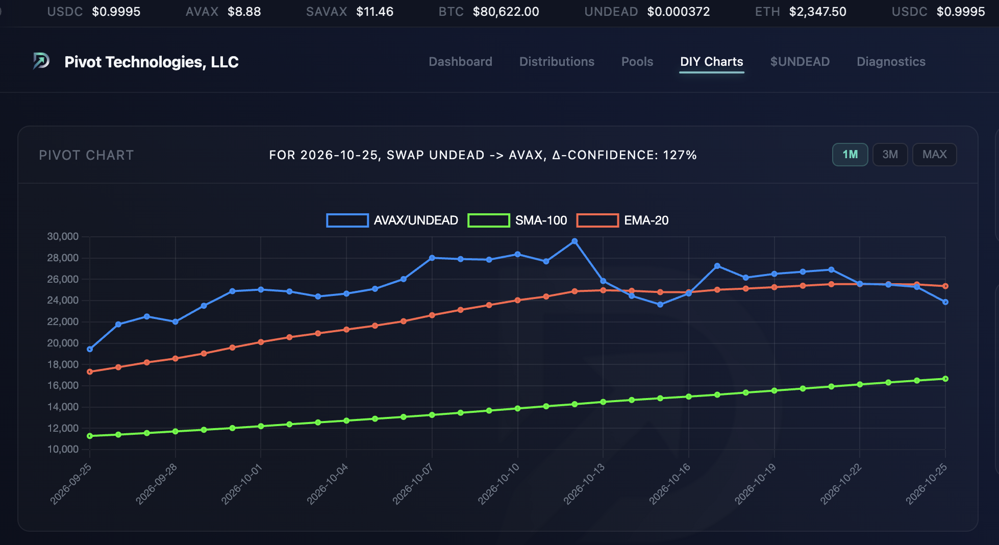
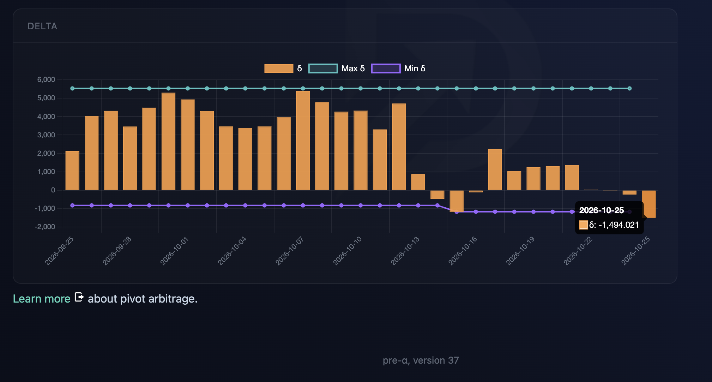
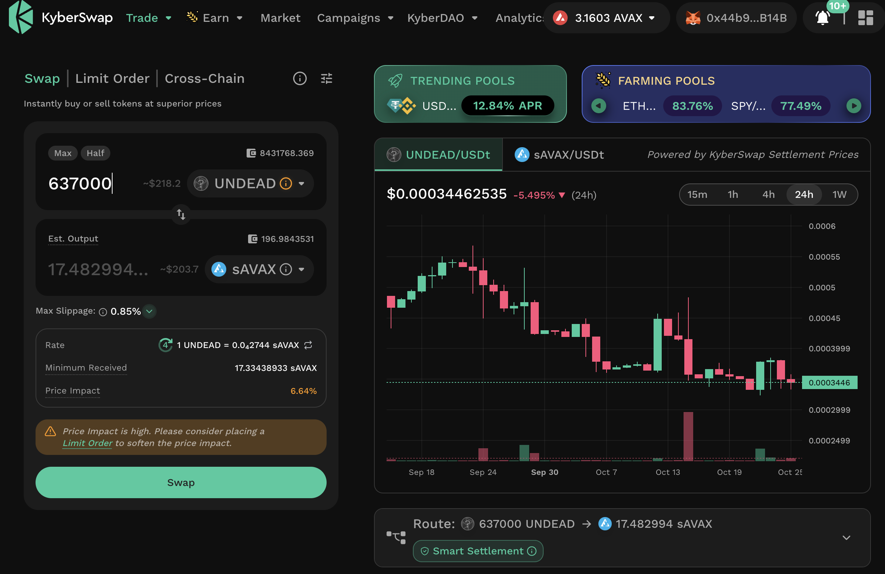
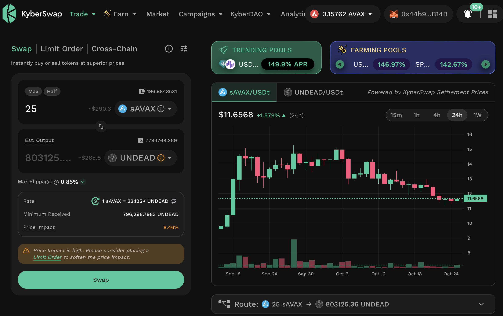

# PIVOTS

## AVAX+UNDEAD

HWÆT, pivoteurs, and well-met!

Let's open an UNDEAD-on-AVAX pivot and an AVAX-on-UNDEAD pivot, as per the 
[Pivot Protocol 
indicators](https://pivoteur.github.io/diy.html?t1=AVAX&t2=UNDEAD).
