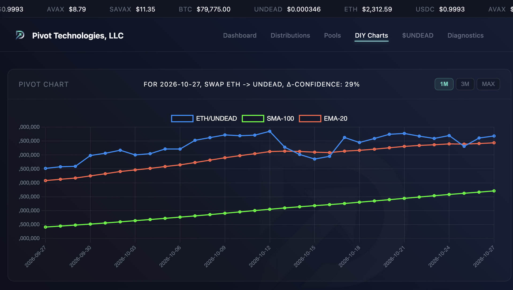
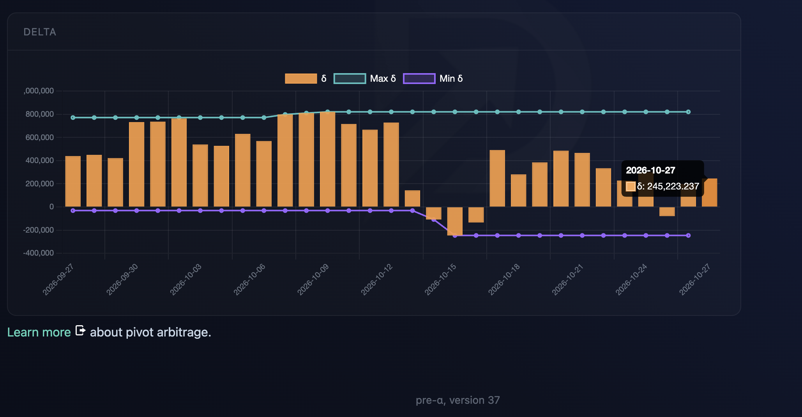
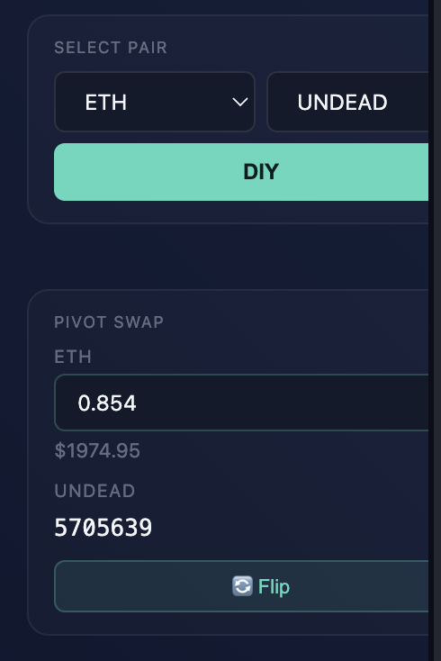
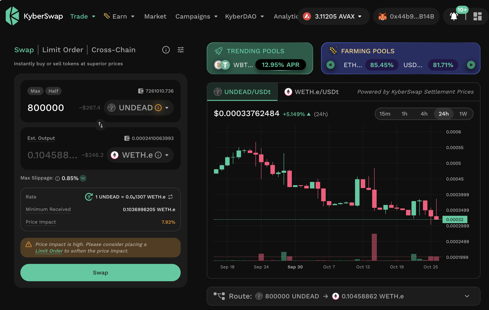

# PIVOTS

## ETH+UNDEAD

HWÆT, pivoteurs, and well-met!

Let's open an ETH-on-UNDEAD pivot and an UNDEAD-on-ETH hedge, as per [Pivot 
protocol indicators](https://pivoteur.github.io/diy.html?t1=ETH&t2=UNDEAD).
